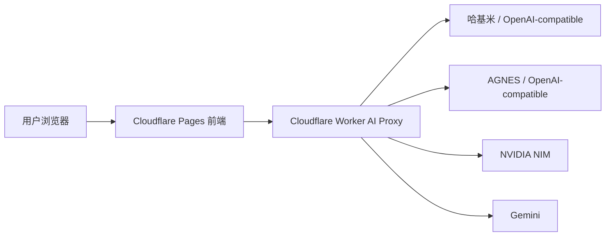

# ikunKChat

ikunKChat 是一个基于开源项目二次开发的公益 AI 聊天站点。当前版本采用“前端只连接 Cloudflare Worker，API Key 只配置在 Worker 中”的架构，用户无需自行填写 API Key，即可使用站点提供的模型渠道。

线上地址：

- 主站：[https://hjm.331106.xyz](https://hjm.331106.xyz)
- 备用域名：[https://yx-hjm.331106.xyz](https://yx-hjm.331106.xyz)
- 备用域名：[https://eo-hjm.331106.xyz](https://eo-hjm.331106.xyz)

## 当前架构



前端只需要配置 Worker 地址。所有真实 API Key、渠道 baseUrl、模型列表、模型映射都放在 Worker 的 `AI_ROUTES_JSON` 中，避免密钥暴露到浏览器产物里。

## 功能特性

- 多渠道模型选择：按渠道分组展示模型，支持同名模型区分不同 route。
- Worker 代理：统一转发 OpenAI-compatible、Gemini、NVIDIA NIM 等接口。
- 公益站模式：用户无需配置 API Key，直接使用站点预置渠道。
- 聊天体验：流式输出、思考内容展示、Markdown/KaTeX/代码块渲染、图片预览。
- 文件能力：支持 txt、md、docx、pdf 文本提取后参与对话。
- 本地数据：聊天、角色、设置等保存在浏览器本地存储/IndexedDB。
- 公益广告：接入“公益中国”寻亲信息，支持缓存、当天关闭、hover/移动端详情。
- 访问统计：通过自建 Umami 采集访问并展示全站访客和浏览量，localhost 不统计。

## 项目结构

```text
components/              React UI 组件
components/app/          应用壳、布局、弹窗协调
components/chat/         聊天头部、输入框、消息交互
components/common/       通用组件，如公益广告
contexts/                React Context
hooks/                   状态、设置、聊天数据和消息逻辑
services/                LLM、存储、PDF、IndexedDB 等服务
utils/                   工具函数
workers/ai-proxy.js      Cloudflare Worker AI 代理
docs/                    部署和 Worker 配置文档
public/                  静态资源与 PWA 文件
```

## 本地开发

安装依赖：

```bash
npm install
```

只启动前端：

```bash
npm run dev
```

同时启动本地 Worker 和前端：

```bash
npm run dev:local
```

`npm run dev:local` 会在 `workers/` 目录启动 Wrangler，并把前端临时指向 `http://127.0.0.1:8787`。适合验证 Worker 路由、模型列表和聊天请求。

构建生产版本：

```bash
npm run build
```

预览生产构建：

```bash
npm run preview
```

## 前端环境变量

Cloudflare Pages 只需要配置公开变量：

```env
VITE_WORKER_API_BASE_URL="https://你的-worker地址.workers.dev"
VITE_TITLE_MODEL_NAME="用于标题生成的模型名"
```

不要在 Pages 前端变量中配置真实 API Key。所有 `VITE_*` 变量都会被打包到浏览器端。

## 网站访问统计

本站使用 [自建 Umami](https://umami.331106.xyz)，在 `index.html` 全局加载一次 Tracker；`services/umamiAnalyticsService.ts` 通过公开分享接口获取临时令牌，再读取全站统计，`PageMeterBar.tsx` 展示 `visitors`（全站访客）和 `pageviews`（全站访问）。

- Website ID：`df97b1f0-1c5f-4592-afb9-7b00378dc438`
- 分享链接：[ikunKChat 访问统计](https://umami.331106.xyz/share/MIJSOS9Fy1RefgOF)
- 采集域名：`hjm.331106.xyz,yx-hjm.331106.xyz,eo-hjm.331106.xyz`，三个域名汇总到同一网站。
- 不采集 URL 查询参数和 hash，尊重浏览器 Do Not Track。localhost 和预览域名不会上报访问；localhost 也不查询或显示统计。
- 公开统计按 `Asia/Shanghai` 查询全部可用历史；临时分享令牌只在内存缓存 5 分钟，请求超时为 15 秒，遇到 401 最多刷新令牌重试一次。请求失败保留 `--`，不显示成零访问。

更换网站或实例时，同时更新 `index.html` 中的 Tracker 配置和 `services/umamiAnalyticsService.ts` 中的地址、Website ID、Share ID。前端只使用公开分享令牌，不需要管理员令牌或数据库密钥。旧计数服务的历史数据不会自动迁移到 Umami。

部署后在正式域名检查 `/script.js`、`/api/send`、`/api/share/MIJSOS9Fy1RefgOF` 和 `/api/websites/{websiteId}/stats` 是否成功，并核对页面数字与 Umami 分享页。采集和公开统计查询是独立流程。

## Worker 配置

Worker 的核心变量是 `AI_ROUTES_JSON`。每个渠道包含 `id`、`name`、`provider`、`baseUrl`、`apiKey` 或 `apiKeys`、`models`，必要时可加 `modelMap`。同一渠道有多个 Key 时，推荐使用 `apiKeys` 数组；Worker 会轮询 Key，并在网络错误、限流或上游错误时尝试剩余 Key。

示例：

```json
[
  {
    "id": "api-one",
    "name": "哈基米",
    "provider": "openai",
    "baseUrl": "https://example.com",
    "apiKey": "sk-...",
    "models": ["gemini-auto"]
  },
  {
    "id": "nvidia",
    "name": "NVIDIA",
    "provider": "nvidia",
    "baseUrl": "https://integrate.api.nvidia.com",
    "apiKeys": [
      { "id": "nvidia-01", "key": "nvapi-..." },
      { "id": "nvidia-02", "key": "nvapi-..." }
    ],
    "models": ["gpt-oss-120b"],
    "modelMap": {
      "gpt-oss-120b": "openai/gpt-oss-120b"
    }
  }
]
```

### 更新已经部署的 Worker

如果 Worker 已经在线运行，不需要重新创建 Worker，也不需要重复设置没有变化的 Secret。确认 `workers/wrangler.ai-proxy.example.toml` 中的 `name` 仍是现有 Worker 名称，然后在项目目录执行：

```bash
cd workers
npx wrangler d1 migrations apply ikunkchat-analytics --remote --config wrangler.ai-proxy.example.toml
npx wrangler secret put ADMIN_PASSWORD --config wrangler.ai-proxy.example.toml
npx wrangler secret put AI_ROUTES_JSON --config wrangler.ai-proxy.example.toml
npx wrangler deploy --config wrangler.ai-proxy.example.toml
```

- `d1 migrations apply`：把后台统计表更新到已经绑定的远程 D1 数据库；已经执行过相同迁移时 Wrangler 会自动跳过。
- `ADMIN_PASSWORD`：本次新增的后台登录密码，只需首次启用后台时设置，之后密码不变可跳过。
- `AI_ROUTES_JSON`：只有渠道、模型或 Key 变化时才需要更新。输入时只粘贴从 `[` 到 `]` 的 JSON，不要粘贴 `.dev.vars` 外层的变量名和引号。
- `ACCESS_PASSWORD`、`AUTH_SECRET`：如果线上已有且内容不变，无需重新设置。
- `wrangler deploy`：将当前 `workers/ai-proxy.js` 更新到同名的现有 Worker，不会重新创建 Pages 站点。
- Worker 配置中的定时任务会每天 UTC 03:00 清理 D1 中超过 90 天的调用日志；修改 `workers/wrangler.ai-proxy.example.toml` 后重新执行 `wrangler deploy` 才会生效。

如果尚未给线上 Worker 创建或绑定统计数据库，先按 [Cloudflare Worker API Proxy](docs/cloudflare-worker-proxy.md#analytics-database) 中的首次 D1 配置完成一次创建和绑定，再执行以上增量更新命令。

更多说明见 [Cloudflare Worker API Proxy](docs/cloudflare-worker-proxy.md)。

## 部署流程

1. 提交并推送前端代码到 GitHub。
2. Cloudflare Pages 自动构建并部署前端。
3. 如改动 Worker 代码，执行 `wrangler deploy`。
4. 如改动模型渠道、Key 或模型列表，更新 Worker secret `AI_ROUTES_JSON`。

## 安全说明

- 不要提交 `.env`、`workers/.dev.vars` 或任何真实 API Key。
- `AI_ROUTES_JSON` 应作为 Worker secret 管理。
- 前端只保存 Worker 地址，不保存上游渠道密钥。
- 本地 `.dev.vars` 只用于 `wrangler dev`。

## 致谢

本项目基于 [KChat](https://github.com/KuekHaoYang/KChat) 及原 ikunKChat 项目继续二次开发。感谢原作者和开源社区提供的基础工作。
